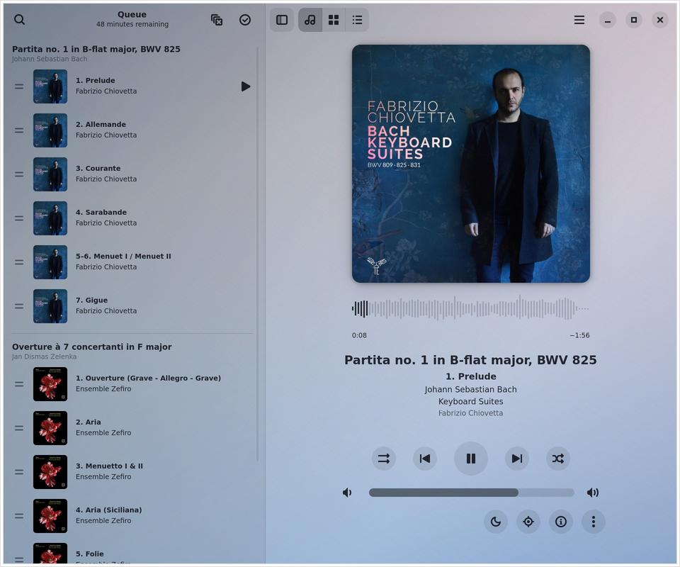
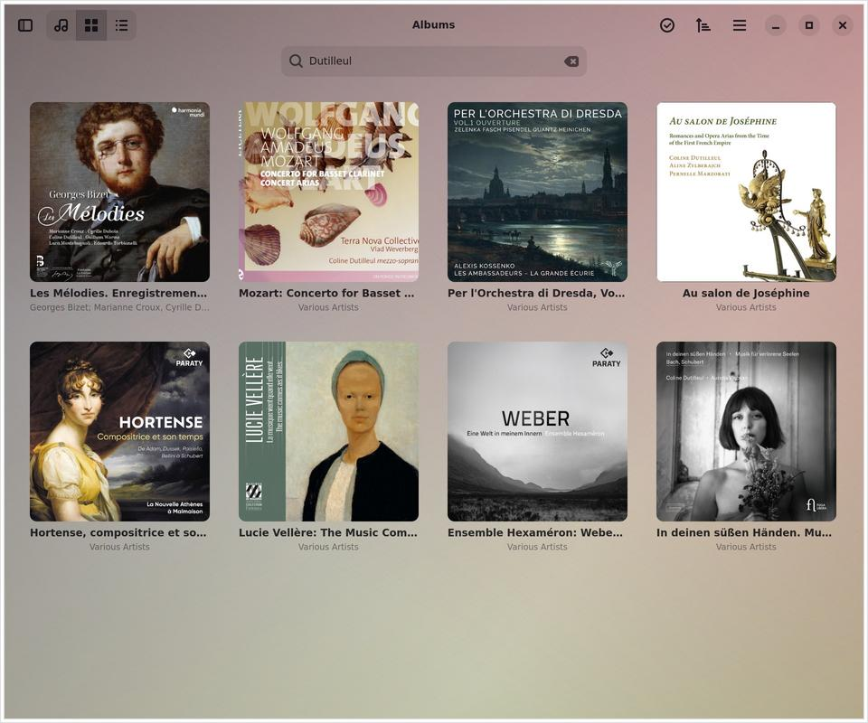

Dismas
======


A music player written in Rust with GTK4 and libadwaita. It fits in well on
GNOME desktops.

Dismas is a fork of [Amberol](https://gitlab.gnome.org/World/amberol) by
Emmanuele Bassi. Upstream Amberol sets out to play music and nothing else: it
doesn't manage a collection or playlists. Dismas keeps its look and its
GStreamer core, and adds the library and playlist features that upstream
deliberately leaves out.





Dismas is not affiliated with the upstream project. Please don't report its
bugs upstream or send its changes there. Upstream doesn't accept
contributions made with AI tools, and much of Dismas was written with Claude.

What Dismas adds
----------------

- **Album grid:** browse the albums in your Music folder, sorted by artist,
  title, year or date added, and select albums or tracks to play or add to
  the queue.
- **Search by any tag:** searching the albums or the queue looks in every
  tag of the tracks, not just the title, artist and album. Find a recording
  by its conductor, soloist, orchestra, ensemble, composer, work or label,
  and combine them: "Karajan Brahms" finds the tracks with both. Case and
  accents don't matter, so "dvorak" finds Dvořák. Searching the albums shows
  each album with only the tracks that match.
- **Playlists:** save the queue as a playlist, and create, rename and delete
  playlists. Switch between them on the Playlists page. Import and export M3U
  playlists. Exported paths are relative to the playlist's folder, so you can
  copy a playlist along with the music to another device.
- **Queue editing:** drag tracks to reorder them, and select ranges with
  Shift+click.
- **Classical music:** shows work and movement names (including the tags written
  by the [Work Hierarchy](https://github.com/dachshund7/work-hierarchy) plugin
  for Picard), composers and performers, and production credits in the track
  information.
- **Sleep timer:** stops the music after a set number of minutes. It can stop
  right away, or let the track that's playing when time runs out finish
  first.
- **Tray icon:** while Background Playback is on, Dismas shows an icon in the
  tray. Click it to show or close the window, middle-click it to play or
  pause, scroll over it to change the volume, or use its menu. It needs a
  tray that supports StatusNotifierItem: KDE Plasma; the Xfce, Cinnamon, LXQt
  and Budgie panels; waybar and swaybar; and Ubuntu's GNOME. Bars with only an
  XEmbed tray (i3bar, polybar, tint2, stalonetray) need
  [snixembed](https://git.sr.ht/~steef/snixembed), which doesn't pass on
  middle clicks or which way the wheel turns, and stock GNOME needs the
  AppIndicator extension. Without a tray, the music still plays in the
  background, and the media controls or opening Dismas again bring it back.
- **Layout:** the player fits itself to the window, and the cover and waveform
  grow into any spare room. Turn off Show Waveform in Preferences for a plain
  seek bar instead.
- **Robustness:** tags and covers load in parallel worker threads, and cover
  art is decoded in sandboxed [glycin](https://gitlab.gnome.org/GNOME/glycin)
  loaders. Unreadable files, odd tags and file names that aren't valid UTF-8
  are skipped rather than crashing the app.

Keyboard shortcuts
------------------

| Shortcut            | Action                        |
|---------------------|-------------------------------|
| Space               | Play / pause                  |
| Alt+← / Alt+→       | Previous / next track         |
| Ctrl+← / Ctrl+→     | Seek backward / forward       |
| Ctrl+1 / 2 / 3      | Player / albums / playlists   |
| Ctrl+F              | Search the queue              |
| Ctrl+G              | Search the albums             |
| Ctrl+I              | Track information             |
| Ctrl+R              | Shuffle                       |
| Ctrl+L              | Clear the queue               |
| F9                  | Show or hide the playlist pane |
| Ctrl+Q              | Quit                          |

Building
--------

There are no packaged builds of Dismas, so you need to build it from
source. You'll need Meson, Ninja, Rust, `blueprint-compiler`, gettext, and the
development files for gtk4 ≥ 4.19.5, libadwaita ≥ 1.8, GStreamer ≥ 1.20
(including plugins-bad), SQLite, libseccomp and fontconfig. Decoding cover
art needs the glycin loaders at run time, plus `bwrap` outside Flatpak.

```sh
meson setup _build                     # add -Dprofile=development for a debug build
meson compile -C _build                # or: ninja -C _build
meson devenv -C _build ./src/dismas    # run without installing
```

To install it, run `meson install -C _build`. By default, that installs
system-wide, under `/usr/local`; to install it for yourself only, set up the
build with `meson setup _build --prefix ~/.local` instead.

To build a Flatpak instead, with `flatpak-builder`:

```sh
flatpak-builder --user --install --install-deps-from=flathub --force-clean \
    flatpak-build io.github.dachshund7.Dismas.json
flatpak run io.github.dachshund7.Dismas.Devel
```

That builds the development version, which has its own ID, so it can be
installed next to a regular build. Each CI run on GitHub also makes one, as
`dismas-devel.flatpak` in the run's artifacts; install it with
`flatpak install --user dismas-devel.flatpak`.

Dismas has its own application ID, `io.github.dachshund7.Dismas`, so it can be
installed alongside Amberol. On its first run, it copies Amberol's library,
queue, playlists and settings, if it finds them; Amberol's own copies are left
alone.

For a full debug log, run:

    RUST_BACKTRACE=1 RUST_LOG=dismas=debug meson devenv -C _build ./src/dismas

or, once it's installed:

    RUST_BACKTRACE=1 RUST_LOG=dismas=debug dismas

Contributing
------------

See the [contribution guide](./CONTRIBUTING.md). Contributions made with AI
tools are welcome.

Translations
------------

Strings inherited from upstream Amberol come with its translations. Strings
added in Dismas appear in English until someone translates them here, and so do
translations that spelled or declined the name "Amberol" in a way that couldn't
simply be swapped for "Dismas".

Why is it called "Dismas"?
--------------------------

It's named after [Jan Dismas
Zelenka](https://en.wikipedia.org/wiki/Jan_Dismas_Zelenka) (1679–1745), the
Czech Baroque composer who worked at the court in Dresden.

Copyright and licensing
-----------------------

Copyright 2022  Emmanuele Bassi, and the contributors to Amberol and Dismas

Released under the terms of the GNU General Public License, either version 3.0
or, at your option, any later version.
