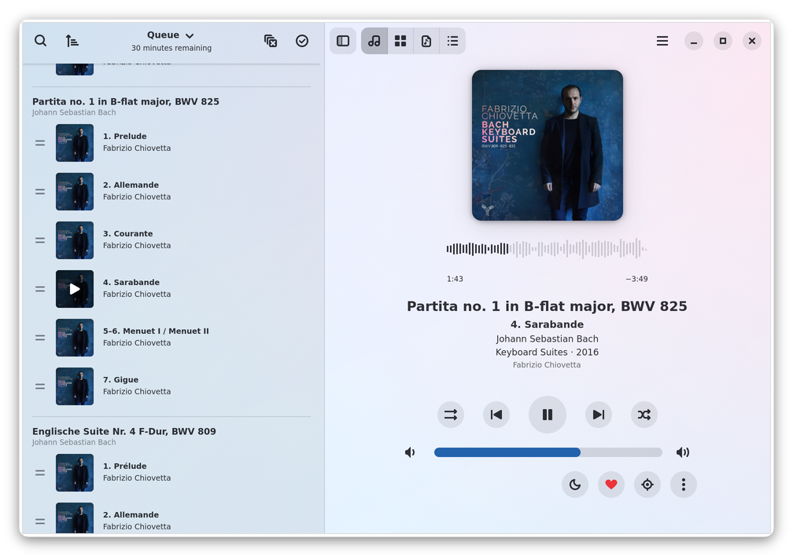
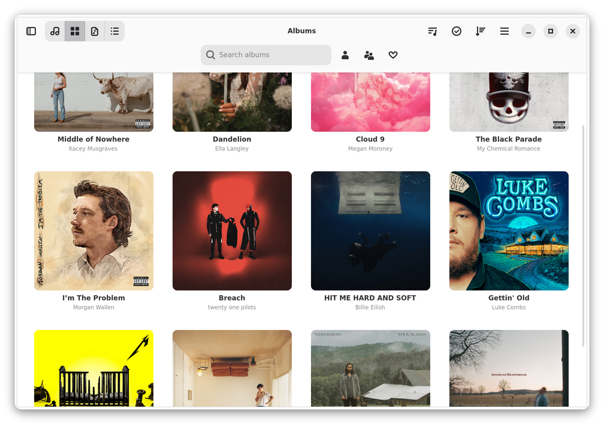
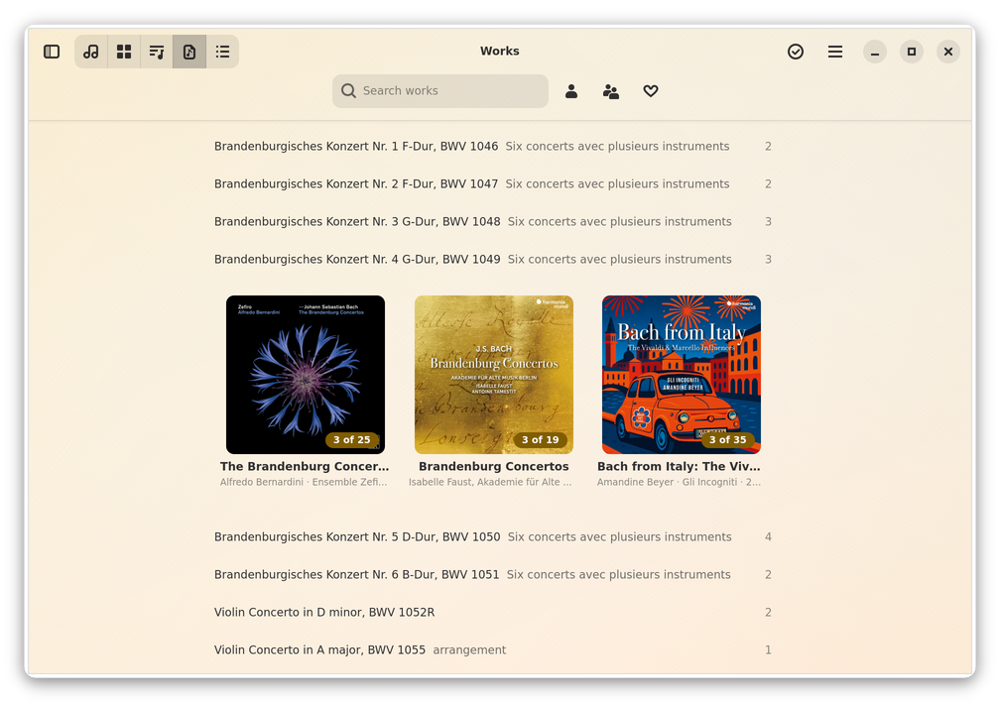
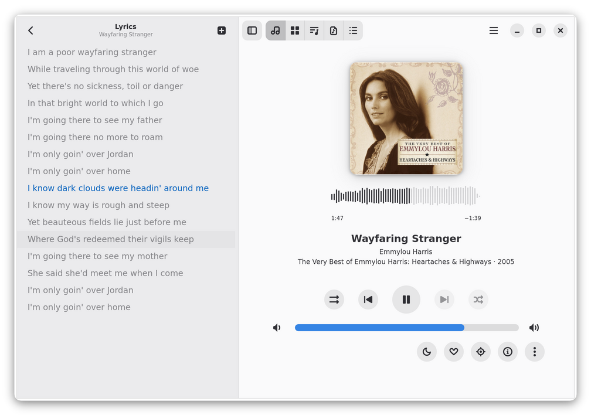
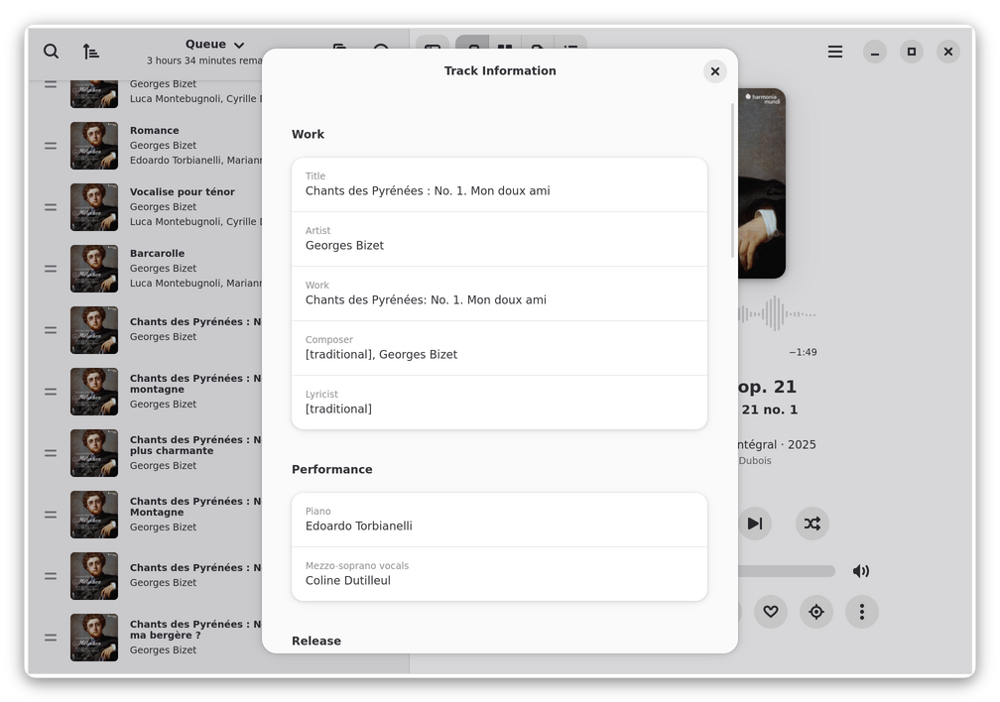
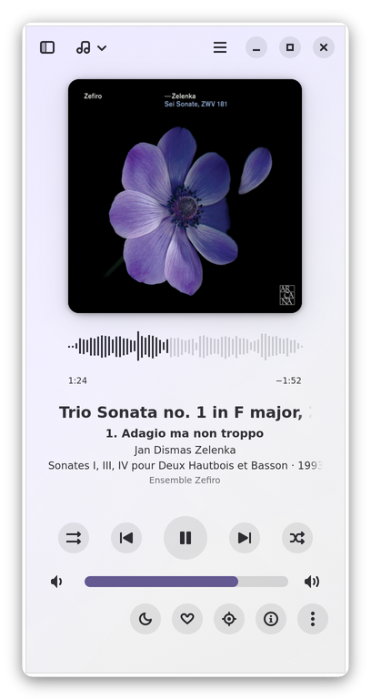
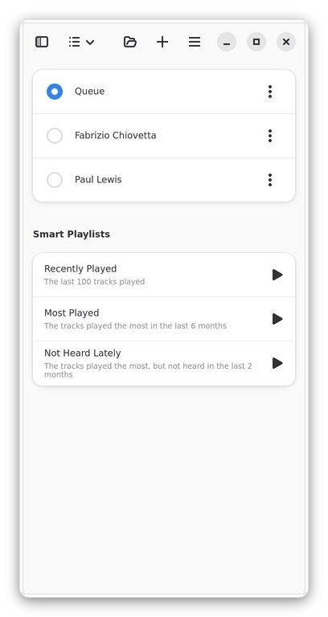

Dismas
======


A player for the music on your computer, with an album grid, a powerful
search, playlists, and the works, movements and performers that classical
music needs. It's written in Rust with GTK4 and libadwaita, and fits in well
on GNOME desktops.

Dismas is a fork of [Amberol](https://gitlab.gnome.org/World/amberol) by
Emmanuele Bassi. It holds to these rules:

- **It only reads your music.** Dismas never changes your music files or
  folders: it doesn't edit tags, rename or move files, or save covers next
  to your tracks. Its library, playlists, play history and caches stay in
  `~/.local/share/dismas` and `~/.cache/dismas`, and the only file it writes
  anywhere else is a playlist you export.
- **It doesn't need the network.** It has no accounts, no streaming and no
  telemetry, and it doesn't download covers, lyrics or biographies: everything
  it shows comes from your files. The Flatpak has no network access at all.
  The MusicBrainz links in Track Information open in your web browser.
- **What you listen to stays on your computer.** The play history, which the
  smart playlists and the shuffle use, is never sent anywhere. You can stop
  keeping it, or clear it, in Preferences.
- **It's a GNOME app.** It's built with libadwaita, follows the light or dark
  style of the desktop, and fits in a window as narrow as 360 pixels, as on a
  phone.

Features
--------

- **Album grid:** browse the albums in your music folders, sorted by artist,
  title, year or date added. Add folders in Preferences, such as one on a
  second drive, and leave out folders inside them. New, changed and removed
  tracks show up by themselves, and the albums of a drive that's unplugged
  come back with it.
- **Search by any tag:** the album search and the queue search look in every
  tag, not just the title, artist and album, so "Karajan Brahms" finds a
  recording by its conductor and its composer. Case and accents don't matter,
  so "dvorak" finds Dvořák. An album that only partly matches says how many
  of its tracks do, and the Tracks toggle (Ctrl+T) plays or adds only those.
- **Search syntax:** both searches take fields, ranges, dates, `OR` and `NOT`,
  and know what you've listened to:
  - `catalogue:bwv1046..1051 year:<1970` finds the Brandenburg Concertos in
    recordings from before 1970
  - `(beatles OR kinks) year:1966 -is:live` finds the tracks of either band
    from 1966, leaving out live recordings
  - `plays:10.. played:<-2m` finds what you've played ten times or more, but
    not in the last two months

  Search Syntax, in the main menu, lists every field, and the
  [wiki](https://github.com/dachshund7/dismas/wiki/Search-syntax-examples)
  has many more examples.
- **Composers and performers:** the buttons beside the album search list the
  composers of your albums, and their conductors, ensembles, soloists and
  bands. Pick one to see their albums, or one of each to see where they meet.
- **Works:** the Works page lists the works by composer, in the order of their
  catalogue numbers, with how many recordings each has. Open one to compare
  the albums it's recorded on, or go there from a movement with Go to Work.
- **Classical music:** the queue and the album view show each work above its
  movements, and the player names the composers and the performers. Albums
  and recordings go by the year they were recorded, or else first released,
  rather than the year of a reissue. Track Information shows the work, the
  performers and the production credits, and Open Booklet opens any PDF in an
  album's folder. Dismas reads the tags written by the
  [Work Hierarchy](https://github.com/dachshund7/work-hierarchy) plugin for
  Picard, and the wiki lists the
  [Picard settings](https://github.com/dachshund7/dismas/wiki/Picard-settings)
  that give it the most to show.
- **Playlists:** save the queue as a playlist, and import and export M3U
  files. A click on the Playlists page shows a playlist's tracks in the pane
  while the music goes on. Each playlist resumes where it was, when you switch
  back to it and when Dismas starts, and tracks whose files are missing stay
  in their places, greyed out, until they're back.
- **Smart playlists and favorites:** Recently Played, Most Played and Not
  Heard Lately pick tracks from what you've listened to. Mark tracks, albums,
  works and recordings as favorites, and play a random album, track or work,
  more likely one you haven't heard lately.
- **Queue:** drag tracks to reorder them, or use Alt+Up and Alt+Down. Play
  Next puts a track after the playing one, or after the last movement of the
  work that's playing. Sort the playlist once by album, artist, composer,
  title, year or file name, and undo sorting or removing tracks with Ctrl+Z.
  Drop files and albums between the tracks, where you want them.
- **Gapless playback:** tracks play back to back, so movements and live
  recordings that run into each other aren't cut by a gap.
- **Shuffle:** it goes by what you've heard. Tracks heard in the last few days
  tend to go toward the end, and tracks played often but not heard for a while
  tend to come early. The movements of a work stay together and in order, the
  same artist doesn't come twice in a row, and turning shuffle off puts back
  the order from before.
- **ReplayGain:** choose Album, Track, or Automatic, which takes the album gain
  while an album plays in order and the track gain otherwise, and set a
  pre-amp. Dismas reads ReplayGain tags and the R128 gains of Opus files. It
  doesn't measure tracks itself, as it never changes your files; a tool such
  as [rsgain](https://github.com/complexlogic/rsgain) can tag them.
- **CUE sheets:** an album ripped to a single file is split into its tracks
  by a `.cue` file next to it or a `CUESHEET` tag, each with its own
  ReplayGain.
- **Lyrics:** Ctrl+Shift+L shows the lyrics of the playing track in the pane,
  from an LRC or text file next to it, or from its tags. Synchronized lyrics
  follow the music, and a click on a line plays from it.
- **Other file types:** formats whose tags Dismas can't read itself, such as
  Ogg FLAC, Matroska, WMA, TrueAudio and AC-3, are read through GStreamer, as
  long as it has the plugins to play them, though it reads fewer of their
  tags. Each file is read in a sandboxed process of its own, so a crafted file
  that crashed or exploited a plugin only leaves that file unread. Covers are
  decoded in sandboxed
  [glycin](https://gitlab.gnome.org/GNOME/glycin) loaders.
- **Sleep timer:** stop the music after a set number of minutes, at the end of
  the playing track, or at the end of the work that's playing.
- **Background playback:** turned on in Preferences, it keeps the music going
  with the window closed, and adds a tray icon to control it. The icon needs
  a tray that supports StatusNotifierItem: stock GNOME needs the AppIndicator
  extension, and bars with only an XEmbed tray need
  [snixembed](https://git.sr.ht/~steef/snixembed).
- **Media controls:** the desktop's media controls (MPRIS) can play, seek, and
  change the volume and Shuffle, and they get each track's lyrics, rating and
  play count.
- **Layout:** the cover and the waveform grow into any spare room, and Match
  Cover Art tints the window with the cover's colors. With Zen Mode on, the
  controls fade out once the pointer leaves the window, and in fullscreen
  (F11) the player sits by itself over a blurred copy of the cover. Ctrl+plus
  and Ctrl+minus make the album covers and the lyrics larger or smaller.

Screenshots
-----------














Keyboard shortcuts
------------------

| Shortcut                         | Action                                         |
|----------------------------------|------------------------------------------------|
| Space                            | Play / pause                                   |
| Alt+← / Alt+→                    | Previous / next track                          |
| Ctrl+← / Ctrl+→                  | Seek backward / forward                        |
| Ctrl+↑ / Ctrl+↓                  | Volume up / down                               |
| Ctrl+M                           | Mute or unmute                                 |
| Ctrl+R                           | Change the repeat mode                         |
| Ctrl+S                           | Shuffle, or put back the order from before     |
| Ctrl+D                           | Mark or unmark the playing track as a favorite |
| Ctrl+I                           | Track information                              |
| Ctrl+Shift+L                     | Show or hide the lyrics                        |
| Ctrl+C                           | Copy the details of the track with the focus, or else of the playing track |
| Ctrl+1 to Ctrl+3                 | Player / albums / works                        |
| Ctrl+T                           | Take only the matching tracks, or whole albums |
| Ctrl+P                           | Playlists                                      |
| Ctrl+F                           | Search where the focus is: the albums or works, or the playlist |
| F5                               | Scan the music folders for changes             |
| Ctrl+O / Ctrl+Shift+O            | Add tracks / a folder to the playlist          |
| Ctrl+L                           | Remove all the tracks of the playlist          |
| Ctrl+A                           | Select all the tracks or albums                |
| Delete                           | Remove the selected tracks                     |
| Alt+↑ / Alt+↓                    | Move the track with the focus up / down        |
| Ctrl+Z                           | Undo                                           |
| Menu or Shift+F10                | Open the menu of a track or an album           |
| Ctrl+plus / Ctrl+minus           | Make the album covers or the lyrics larger / smaller; Ctrl and the mouse wheel too |
| Ctrl+0                           | Album covers or lyrics at their normal size    |
| Esc                              | Cancel a drag, leave selection mode, hide the playlist pane, or leave fullscreen |
| Page Up / Page Down / Home / End | Scroll the list under the pointer              |
| F9                               | Show or hide the playlist pane                 |
| F10                              | Main menu                                      |
| F11                              | Fullscreen                                     |
| Ctrl+,                           | Preferences                                    |
| Ctrl+?                           | Keyboard shortcuts                             |
| Ctrl+W                           | Close the window, or the dialog over it        |
| Ctrl+Q                           | Quit                                           |

Command line
------------

```sh
dismas FILE…           # open the files and folders in place of the queue, or
                       # add them to the selected playlist if Dismas is running
dismas --add FILE…     # add them to the end of the selected playlist, without
                       # bringing up the window of a running Dismas
dismas --play FILE…    # play them in place of the queue, with an Undo
```

Folders are read with their subfolders, and an M3U playlist gives its tracks,
found as when it's imported. If Dismas isn't running, `--add` and
`--play` start it and open the selected playlist first, as at any startup:
`--add` then adds to that playlist, and the Undo of `--play` puts it back.

Installing and building
-----------------------

The releases after 2026.10 on GitHub come with a Flatpak, `dismas.flatpak`.
Install it with `flatpak install --user dismas.flatpak`, which installs the
GNOME runtime it needs from Flathub too. Dismas isn't on Flathub itself.

They also come with a prebuilt tarball, `dismas-<version>-x86_64.tar.xz`,
for those who'd rather not use Flatpak, on distributions with GNOME 49's
libraries or newer. Unpack it anywhere, and run `bin/dismas` in its folder.
`./install.sh` adds it to your menu, and `./install.sh --uninstall` takes it
out again. It needs, from your distribution:

- glibc 2.39 or later
- GTK 4.20 or later and libadwaita 1.8 or later
- GStreamer 1.20 or later, with the base, good and bad plugins, and for
  WMA files, the ugly plugins and gst-libav
- the glycin loaders and `bwrap`, to read the covers
- SQLite 3.45.3 or later, libseccomp and fontconfig

It's the same app as Dismas built from source, with the same settings,
library and playlists, and `install.sh` doesn't replace a build from source
installed in `~/.local`.

Otherwise, you need to build Dismas from source. You'll need Meson, Ninja,
Rust, `blueprint-compiler`, gettext, and the development files for gtk4 ≥
4.19.5, libadwaita ≥ 1.8, GStreamer ≥ 1.20 (including plugins-bad), SQLite
≥ 3.45.3, libseccomp and fontconfig. Decoding cover art needs the glycin
loaders at run time, plus `bwrap` outside Flatpak.

```sh
meson setup _build                     # add -Dprofile=development for a debug build
meson compile -C _build                # or: ninja -C _build
meson devenv -C _build ./src/dismas    # run without installing
```

To install it, run `meson install -C _build`. By default, that installs
system-wide, under `/usr/local`; to install it for yourself only, set up the
build with `meson setup _build --prefix ~/.local` instead.

To build a Flatpak instead, with `flatpak-builder`:

```sh
flatpak-builder --user --install --install-deps-from=flathub --force-clean \
    flatpak-build io.github.dachshund7.Dismas.json
flatpak run io.github.dachshund7.Dismas
```

That builds the same Flatpak as the releases. For the development version,
build `io.github.dachshund7.Dismas.Devel.json` instead, and run
`io.github.dachshund7.Dismas.Devel`. It's a debug build, slower at reading a
large library for instance, but it shows the commit it was built from in
About, and it has an ID of its own, so it can be installed next to the
regular Flatpak, with its own library, playlists, play history and settings.
Each CI run on GitHub also makes one, as `dismas-devel.flatpak` in the run's
artifacts; install it with `flatpak install --user dismas-devel.flatpak`.

Dismas can be installed next to Amberol. On its first run, it copies Amberol's
library, queue, playlists and settings, if it finds them, and leaves Amberol's
own copies alone.

For a full debug log, run:

    RUST_BACKTRACE=1 RUST_LOG=dismas=debug meson devenv -C _build ./src/dismas

or, once it's installed:

    RUST_BACKTRACE=1 RUST_LOG=dismas=debug dismas

or, for the Flatpak:

    flatpak run --env=RUST_BACKTRACE=1 --env=RUST_LOG=dismas=debug io.github.dachshund7.Dismas

### Flatpak limitations

The Flatpak keeps Dismas in a sandbox, so it can't reach everything that
Dismas installed without Flatpak can:

- It isn't on Flathub, so it doesn't get updates on its own: each new
  release has to be installed from its `dismas.flatpak`.
- It can read the Music folder and nothing else on its own. Folders
  elsewhere, like one on a second drive, need to be added in Preferences,
  which gives Dismas access to them through the document portal. If that
  access is taken back, the folder shows as unavailable until it's added
  again. Such a folder isn't watched for changes, so it's read again when
  the album grid is shown, at most every 5 minutes. Symbolic links in the
  Music folder that point outside it don't work in the sandbox.
- Files opened or dropped from outside the music folders reach Dismas one at
  a time, through the document portal, without the files next to them. A
  `.cue` sheet then can't reach its audio file, and cover and lyrics files
  next to the tracks aren't found.
- On the command line, only files in the Music folder can be opened.
- WMA Pro and WMA Lossless files aren't read, as the GNOME runtime has no
  decoder for them. Other WMA files play.
- Importing and exporting playlists also goes through the document portal,
  which hides the folder that the playlist file is in. So exported playlists
  have absolute paths, which don't work once the playlist is copied with the
  music to another device, and an imported playlist only finds the tracks
  that it gives by absolute paths in the Music folder.
- Its library, playlists and settings are in
  `~/.var/app/io.github.dachshund7.Dismas/`, apart from those of Dismas
  installed without Flatpak. It can't reach Amberol's, so it doesn't copy them
  on its first run.

Contributing
------------

See the [contribution guide](./CONTRIBUTING.md). Contributions made with AI
tools are welcome, and so are translations: strings added in Dismas appear in
English until someone translates them.

Why is it called "Dismas"?
--------------------------

It's named after [Jan Dismas
Zelenka](https://en.wikipedia.org/wiki/Jan_Dismas_Zelenka) (1679–1745), the
Czech Baroque composer who worked at the court in Dresden. Its icon is the
Katholische Hofkirche in Dresden, the church of the Catholic court that
Zelenka wrote his church music for.

Copyright and licensing
-----------------------

Copyright 2022  Emmanuele Bassi, and the contributors to Amberol and Dismas

Released under the terms of the GNU General Public License, either version 3.0
or, at your option, any later version.
