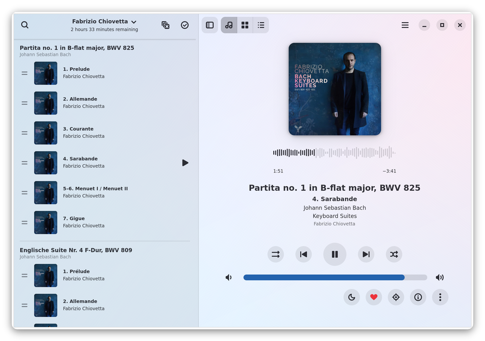
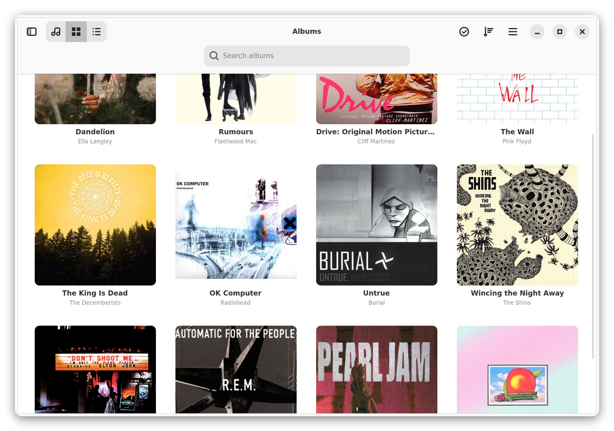
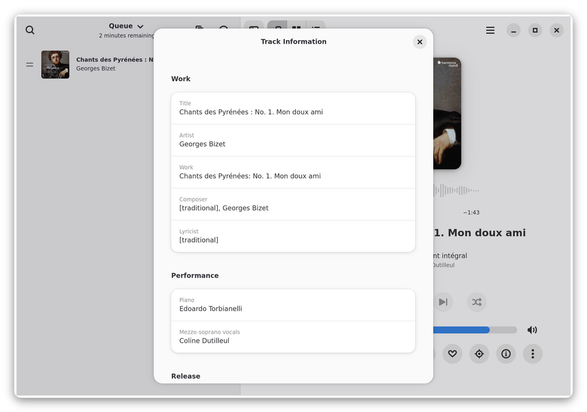
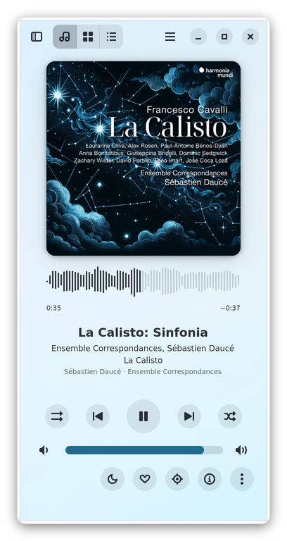
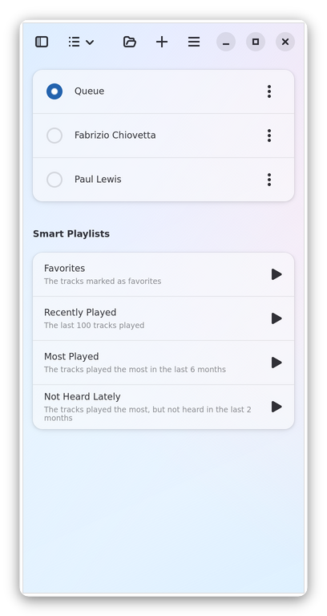

Dismas
======


A player for the music on your computer, written in Rust with GTK4 and
libadwaita. It fits in well on GNOME desktops.

Dismas is a fork of [Amberol](https://gitlab.gnome.org/World/amberol) by
Emmanuele Bassi. Amberol sets out to play music and nothing else: it doesn't
manage a collection or playlists. Dismas keeps Amberol's look and its
GStreamer core, and adds the album grid and the playlists that Amberol leaves
out on purpose. It also keeps Amberol's values:

- **It only reads your music.** Dismas never changes your music files or
  folders. It doesn't edit tags, rename or move files, or save covers next to
  your tracks. Its library, playlists, play history and caches are kept in
  folders of its own, `~/.local/share/dismas` and `~/.cache/dismas`. The only
  file it writes anywhere else is a playlist that you export, where you choose
  to save it. The Flatpak can read the Music folder, but can't write to it.
- **It doesn't need the network.** Dismas doesn't download covers, lyrics or
  artist biographies, and it has no accounts, no streaming and no telemetry.
  Everything it shows comes from your files: their tags, their covers, and
  the cover files next to them. The Flatpak has no network access at all. The
  MusicBrainz links in Track Information open in your web browser.
- **What you listen to stays on your computer.** Dismas keeps a history of
  the tracks you play, for the smart playlists and the shuffle, in a database
  of its own, and doesn't send it anywhere.
- **It's a GNOME app.** It's built with libadwaita, follows the light or dark
  style of the desktop, and fits in a window as narrow as 360 pixels, as on a
  phone.

Dismas is not affiliated with the upstream project. Please don't report its
bugs upstream or send its changes there. Upstream doesn't accept
contributions made with AI tools, and much of Dismas was written with Claude.

What Dismas adds
----------------

- **Album grid:** browse the albums in your music folders, sorted by artist,
  title, year or date added, and select albums or tracks to play or to add to
  a playlist. The Music folder is the default. Other folders, like one on a
  second drive, can be added in Preferences, where each folder can also leave
  out folders inside it, such as audiobooks or podcasts. While a folder isn't
  there, as when its drive isn't plugged in, its albums are hidden, and they
  come back without being read again.
- **Search by any tag:** searching the albums or the queue looks in every
  tag of the tracks, not just the title, artist and album. Find a recording
  by its conductor, soloist, orchestra, ensemble, composer, work or label,
  and combine them: "Karajan Brahms" finds the tracks with both. Case and
  accents don't matter, so "dvorak" finds Dvořák. Searching the albums shows
  each album with only the tracks that match, and adding or playing it takes
  only those, unless Whole Albums, next to the search, is on. The button next
  to the queue's search plays only the tracks it found, in place of the
  queue, with an Undo.
- **Playlists:** save the queue as a playlist, and create, rename and delete
  playlists. Switch between them from the title of the playlist pane or on
  the Playlists page. Each playlist resumes where it was, paused at the same
  track and position, when you switch back to it and when Dismas starts.
  Tracks whose files are missing, such as on a drive that isn't plugged in,
  or can't be read, stay in their places in the playlist, greyed out, and
  playback skips them until their files are back. Import and export M3U
  playlists. Exported paths are relative to the
  playlist's folder, so you can copy a playlist along with the music to
  another device.
- **Smart playlists and favorites:** mark tracks as favorites with the heart
  next to the sleep timer, or with Ctrl+D. On the Playlists page, Favorites
  plays them in the order you marked them, Recently Played plays the last 100
  tracks you heard, Most Played plays the tracks you played the most in the
  last 6 months, and Not Heard Lately plays the tracks you played the most
  but haven't heard in the last 2 months. They play in place of the queue,
  with an Undo.
- **Queue editing and drag and drop:** drag tracks by their handle to
  reorder them, and select ranges with Shift+click. Drop files between the
  tracks of the playlist pane, or drag albums from the grid into place there.
  Elsewhere on the window, files go to one of two zones: the large one adds
  them to the selected playlist, and the one below it plays them in place of
  the queue, with an Undo.
- **Classical music:** the queue and the album view show the name of each
  work above its movements, and the player and the queue show the composers
  and the performers, naming an orchestra or a choir and its soloists rather
  than every player. Track Information shows the work, the performers and the
  production credits. Dismas reads the tags written by the [Work
  Hierarchy](https://github.com/dachshund7/work-hierarchy) plugin for Picard,
  in FLAC, Ogg, Opus, MP3, M4A, AIFF, WAV, Monkey's Audio, WavPack and
  Musepack files.
- **CUE sheets:** an album ripped to a single file is split into its tracks
  by its CUE sheet, a `.cue` file next to it or a `CUESHEET` tag, in the
  album grid, the queue and playlists. Each track gets its own ReplayGain.
- **Sleep timer:** stops the music after a set number of minutes. It can stop
  right away, or let the track that's playing when time runs out finish
  first.
- **Tray icon:** while Background Playback is on (it's off until turned on in
  Preferences), Dismas shows an icon in the tray. Click it to show or close
  the window, middle-click it to play or pause, scroll over it to change the
  volume, or use its menu. It needs a tray that supports StatusNotifierItem:
  KDE Plasma; the Xfce, Cinnamon, LXQt and Budgie panels; waybar and swaybar;
  and Ubuntu's GNOME. Bars with only an XEmbed tray (i3bar, polybar, tint2,
  stalonetray) need [snixembed](https://git.sr.ht/~steef/snixembed), which
  doesn't pass on middle clicks or which way the wheel turns, and stock GNOME
  needs the AppIndicator extension. Without a tray, the music still plays in
  the background, and the media controls or opening Dismas again bring it
  back.
- **Layout:** the player fits itself to the window, and the cover and
  waveform grow into any spare room. Turn off Show Waveform in Preferences
  for a plain seek bar instead. With Zen Mode on, the controls fade out once
  the pointer leaves the window, leaving the cover and the track details in
  the middle, and the cover grows into the room the controls leave. In
  fullscreen (F11), the player is by itself, larger, over a blurred copy of
  the cover, and its controls fade out the same way while the pointer stays
  still.

Screenshots
-----------










Fixes and improvements over Amberol
-----------------------------------

Besides what it adds, Dismas changes some of what Amberol already does:

- **Gapless playback:** tracks play back to back, so movements and live
  recordings that run into each other aren't cut by a gap.
- **Shuffle:** shuffling mixes up the whole playlist, with the playing track
  at the top, where Amberol only mixed up the tracks after the playing one.
  The order from before is kept, even when Dismas is restarted, until turning
  shuffle off puts it back. It goes by what you've heard: tracks heard in the
  last few days tend to go toward the end, and tracks played often but not
  heard for a while tend to come early. The movements of a work stay together
  and in order, and the same artist doesn't come twice in a row.
- **Searching the queue** looks for every word in every tag, rather than
  fuzzy matching, keeps the order of the queue, and says so when it finds
  nothing, rather than leaving the pane blank.
- **Match Cover Art** tints the window with the cover's colors while keeping
  the contrast of the text, takes the accent color from the cover, and turns
  itself off in high contrast.
- **Remembering:** Dismas remembers the volume, the repeat mode and whether
  the playlist pane is open.
- **Background playback:** closing the window while the music plays in the
  background hides it, so it comes back as it was, rather than being made
  again.
- **The end of the queue:** once the queue has played to its end, the last
  track stays shown, and playing again starts over from the first one.
- **Covers:** tags and covers are read in parallel worker threads, and the
  covers are decoded in sandboxed [glycin](https://gitlab.gnome.org/GNOME/glycin)
  loaders, as a crafted image in a tag could otherwise attack the player. The
  player shows the cover at full size, rather than scaled up from a small
  copy. Cover files are found whatever their case or image type, such as
  `Cover.JPG` or `folder.webp`.
- **Missing tags:** a track without a title tag shows its file name, and a
  track without an album tag shows the name of its folder, rather than
  "Unknown title" and "Unknown album".
- **Copy** (Ctrl+C) puts only the title and the artist of the playing track
  on the clipboard, rather than a sentence in the language of the interface.
- **Times** of an hour or more show the hours, as 1:15:00 rather than 75:00.
- **Long names:** a title, artist or album too long for the player scrolls
  through once, rather than over and over for as long as the track is shown,
  which kept the processor busy.
- **The cache:** the waveforms kept in the cache take a tenth of the room,
  and the waveforms and covers in the cache that haven't been used for 90
  days are removed, rather than kept for good.

And it fixes these bugs of Amberol's:

- Crashes on paths that aren't valid UTF-8, on files without a local path, on
  tags that made the tag reader panic, and on a malformed saved queue.
- A file whose header gave an impossible length, such as an Ogg file cut off
  in the middle of a page, crashed the player when it played or was seeked.
- A track that couldn't be played, such as one whose file was gone or with
  no decoder for its format, left the player showing it as playing, with
  nothing heard. Dismas says so and goes on to the next track.
- Where an administrator had locked its settings with dconf, closing the
  window, changing ReplayGain or turning Background Playback on or off
  crashed the player.
- A crafted MusicBrainz release ID could make Amberol write cover thumbnails
  outside its cache directory.
- Other users of the computer could read the folders made for the covers,
  the waveforms and the saved queue, which lists the files in it. The folders
  Dismas makes are private.
- Without a Background portal, as in many window manager sessions, closing
  the window quit even with Background Playback on.
- The desktop's media controls (MPRIS) couldn't set the position, showed an
  old cover, and kept the previous track's position after skipping while
  paused. They didn't show the track at startup, the play/pause media key
  didn't start playback when stopped, and Next on the last track went back
  to the first. A program asking them for a seek of a few centuries, as
  `playerctl position 99999999999+` does, left the player unable to take
  playback commands until it was restarted.
- Waveforms: the previous track's waveform stayed until the new one was
  ready, or was drawn over it, and a waveform that couldn't be read whole was
  cached. When a track repeated, its cover and waveform were loaded again,
  and a track that decodes slower than it plays never got a waveform.
- Seeking in a track that hadn't played yet didn't show.
- With PulseAudio, a track paused before it had started playing, such as by a
  Pause from the desktop's media controls just after startup, stayed silent
  when played a few seconds later, or played with its time and waveform stuck
  where it started.
- Removing a track above the playing one made playback go on to the wrong
  track, removing tracks until one was left stopped the music, and removing
  the playing track with Repeat One kept it playing.
- The time left under the playlist's title counted all of the playing
  track, however much of it had played, and stayed as it was when turning
  shuffle off changed the tracks after it.
- The Play button of the "Added a new track" toast didn't play that track.
- Symbolic links to tracks and folders that were opened or dropped weren't
  followed.
- Ctrl+Left and Ctrl+Right seeked instead of moving the cursor in the search
  entry.
- Searching the queue for "unknown" found every track missing an artist,
  album or title tag, by the words shown in their place.
- A title with braces in it, such as "Hymn to {artist}", came out changed
  in the text that Copy put on the clipboard.
- No cover for a track whose extension doesn't match its type, such as Opus
  in an `.ogg` file. GTK themes made for libadwaita apps, like Colloid, drew
  the outlines of their cards on the covers in the queue.
- The window's size wasn't saved when quitting with Ctrl+Q, only when closing
  the window.
- On X11 without a compositor, files dragged over the part of the window
  gained by widening it went to the window below.
- In the Flatpak, Open Directory failed for tracks opened or dropped from
  outside the Music folder.
- GLib warnings when nothing was left to play.
- `RUST_LOG` didn't change what was logged, so a release build couldn't give
  a debug log.

Keyboard shortcuts
------------------

| Shortcut                         | Action                                         |
|----------------------------------|------------------------------------------------|
| Space                            | Play / pause                                   |
| Alt+← / Alt+→                    | Previous / next track                          |
| Ctrl+← / Ctrl+→                  | Seek backward / forward                        |
| Ctrl+↑ / Ctrl+↓                  | Volume up / down                               |
| Ctrl+D                           | Mark or unmark the playing track as a favorite |
| Ctrl+I                           | Track information                              |
| Ctrl+C                           | Copy the playing track's title and artist      |
| Ctrl+1 / Ctrl+2 / Ctrl+3         | Player / albums / playlists                    |
| Ctrl+G                           | Search the albums                              |
| Ctrl+F                           | Search the queue                               |
| Ctrl+R                           | Shuffle, or put back the order from before     |
| Ctrl+L                           | Remove all the tracks of the playlist          |
| Ctrl+A                           | Select all the tracks or albums                |
| Delete                           | Remove the selected tracks                     |
| Esc                              | Cancel a drag, leave selection mode, hide the playlist pane, or leave fullscreen |
| Page Up / Page Down / Home / End | Scroll the list under the pointer              |
| F9                               | Show or hide the playlist pane                 |
| F10                              | Main menu                                      |
| F11                              | Fullscreen                                     |
| Ctrl+,                           | Preferences                                    |
| Ctrl+?                           | Keyboard shortcuts                             |
| Ctrl+Q                           | Quit                                           |

Command line
------------

```sh
dismas FILE…           # open the files and folders in place of the queue, or
                       # add them to the selected playlist if Dismas is running
dismas --add FILE…     # add them to the end of the selected playlist, without
                       # bringing up the window of a running Dismas
dismas --play FILE…    # play them in place of the queue, with an Undo
```

Folders are read with their subfolders. If Dismas isn't running, `--add` and
`--play` start it and open the selected playlist first, as at any startup:
`--add` then adds to that playlist, and the Undo of `--play` puts it back.

Installing and building
-----------------------

The releases after 2026.10 on GitHub come with a Flatpak, `dismas.flatpak`.
Install it with `flatpak install --user dismas.flatpak`, which installs the
GNOME runtime it needs from Flathub too. Dismas isn't on Flathub itself.

They also come with a prebuilt tarball, `dismas-<version>-x86_64.tar.xz`,
for those who'd rather not use Flatpak, on distributions with GNOME 49's
libraries or newer. Unpack it anywhere, and run `bin/dismas` in its folder.
`./install.sh` adds it to your menu, and `./install.sh --uninstall` takes it
out again. It needs, from your distribution:

- glibc 2.39 or later
- GTK 4.20 or later and libadwaita 1.8 or later
- GStreamer 1.20 or later, with the base, good and bad plugins
- the glycin loaders and `bwrap`, to read the covers
- SQLite, libseccomp and fontconfig

It's the same app as Dismas built from source, with the same settings,
library and playlists, and `install.sh` doesn't replace a build from source
installed in `~/.local`.

Otherwise, you need to build Dismas from source. You'll need Meson, Ninja,
Rust, `blueprint-compiler`, gettext, and the development files for gtk4 ≥
4.19.5, libadwaita ≥ 1.8, GStreamer ≥ 1.20 (including plugins-bad), SQLite,
libseccomp and fontconfig. Decoding cover art needs the glycin loaders at run
time, plus `bwrap` outside Flatpak.

```sh
meson setup _build                     # add -Dprofile=development for a debug build
meson compile -C _build                # or: ninja -C _build
meson devenv -C _build ./src/dismas    # run without installing
```

To install it, run `meson install -C _build`. By default, that installs
system-wide, under `/usr/local`; to install it for yourself only, set up the
build with `meson setup _build --prefix ~/.local` instead.

To build a Flatpak instead, with `flatpak-builder`:

```sh
flatpak-builder --user --install --install-deps-from=flathub --force-clean \
    flatpak-build io.github.dachshund7.Dismas.json
flatpak run io.github.dachshund7.Dismas
```

That builds the same Flatpak as the releases. For the development version,
build `io.github.dachshund7.Dismas.Devel.json` instead, and run
`io.github.dachshund7.Dismas.Devel`. It's a debug build, slower at reading a
large library for instance, but it shows the commit it was built from in
About, and it has an ID of its own, so it can be installed next to the
regular Flatpak, with its own library, playlists, play history and settings.
Each CI run on GitHub also makes one, as `dismas-devel.flatpak` in the run's
artifacts; install it with `flatpak install --user dismas-devel.flatpak`.

Dismas has its own application ID, `io.github.dachshund7.Dismas`, so it can be
installed alongside Amberol. On its first run, it copies Amberol's library,
queue, playlists and settings, if it finds them; Amberol's own copies are left
alone.

For a full debug log, run:

    RUST_BACKTRACE=1 RUST_LOG=dismas=debug meson devenv -C _build ./src/dismas

or, once it's installed:

    RUST_BACKTRACE=1 RUST_LOG=dismas=debug dismas

or, for the Flatpak:

    flatpak run --env=RUST_BACKTRACE=1 --env=RUST_LOG=dismas=debug io.github.dachshund7.Dismas

### Flatpak limitations

The Flatpak keeps Dismas in a sandbox, so it can't reach everything that
Dismas installed without Flatpak can:

- It isn't on Flathub, so it doesn't get updates on its own: each new
  release has to be installed from its `dismas.flatpak`.
- It can read the Music folder and nothing else on its own. Folders
  elsewhere, like one on a second drive, need to be added in Preferences,
  which gives Dismas access to them through the document portal. If that
  access is taken back, the folder shows as unavailable until it's added
  again. Symbolic links in the Music folder that point outside it don't work
  in the sandbox.
- Files opened or dropped from outside the music folders reach Dismas one at
  a time, through the document portal, without the files next to them. A
  `.cue` sheet then can't reach its audio file, and cover files next to the
  tracks aren't found.
- On the command line, only files in the Music folder can be opened.
- Importing and exporting playlists also goes through the document portal,
  which hides the folder that the playlist file is in. So exported playlists
  have absolute paths, which don't work once the playlist is copied with the
  music to another device, and an imported playlist only finds the tracks
  that it gives by absolute paths in the Music folder.
- Its library, playlists and settings are in
  `~/.var/app/io.github.dachshund7.Dismas/`, apart from those of Dismas
  installed without Flatpak. It can't reach Amberol's, so it doesn't copy them
  on its first run.

Contributing
------------

See the [contribution guide](./CONTRIBUTING.md). Contributions made with AI
tools are welcome.

Translations
------------

Strings inherited from upstream Amberol come with its translations. Strings
added in Dismas appear in English until someone translates them here, and so do
translations that spelled or declined the name "Amberol" in a way that couldn't
simply be swapped for "Dismas".

Why is it called "Dismas"?
--------------------------

It's named after [Jan Dismas
Zelenka](https://en.wikipedia.org/wiki/Jan_Dismas_Zelenka) (1679–1745), the
Czech Baroque composer who worked at the court in Dresden. Its icon is the
Katholische Hofkirche in Dresden, the church of the Catholic court that
Zelenka wrote his church music for.

Copyright and licensing
-----------------------

Copyright 2022  Emmanuele Bassi, and the contributors to Amberol and Dismas

Released under the terms of the GNU General Public License, either version 3.0
or, at your option, any later version.
